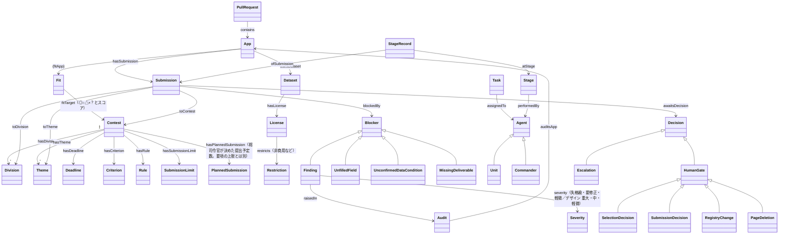

# キャンペーン・オントロジー（第1段）

目的は「賞金を獲得するアプリ・資料を作る」こと。4コンペ・部門・テーマ、案、データとライセンス、作業・判断・PR・監査、部隊を **1つのグラフ（RDF/OWL、JSON-LD が正本）** にし、「この案は出せるか」「何が止めているか」「次にどの部隊が何をするか」を SPARQL で機械的に答える。画面（グラフ＋カード）は統合ダッシュボードの `ontology/index.html`（第2段。`contests/dashboard/README.md`）。ここは画面が読む JSON（`graph.json`・`next-actions.json`）までを用意する。

- 正本: `schema.jsonld`（スキーマ）と `campaign.jsonld`（データ）。どちらも生成物。手で書き換えない。
- すべての事実に出典（`c:hasSource` → `c:Source`。ファイルパス＋節・行、または URL）が付く。取り出せなかった項目は値を作らず `c:extracted "未抽出: …"` を付ける（一覧は `build-report.json`）。
- IRI（`https://geo-campaign-2026.example/…`）は識別子で、実在の URL ではない。

## ファイル
| ファイル | 役割 |
|---|---|
| `schema.py` → `schema.jsonld` | クラスと関係の定義（OWL）。`python3 schema.py` で書き出す |
| `build_graph.py` → `campaign.jsonld`, `build-report.json` | 既存の正本から生成。`--offline` で gh を呼ばない／`--check` で最新か検査 |
| `mappings.py` | 手で決めた対応表（アプリ↔ディレクトリ、監査↔アプリ、段階の証拠ファイル、ライセンス・データの名寄せ）。値は書かない |
| `tsliteral.py`, `mdextract.py` | TypeScript リテラルと Markdown（表・見出し・穴）の読み取り |
| `shapes.ttl`, `validate.py` | SHACL。必須の関係（出典・重大度・人間の関門）の検査 |
| `queries/q*.rq` | SPARQL 問い合わせ集（下記） |
| `next_actions.py` | 問い合わせを実行して「次の行動」を md / JSON で出す |
| `graph_json.py` → `graph.json` | 画面用のノード・エッジ JSON |
| `ui_json.py` → `next-actions.json` | 画面用の「次の行動」JSON（`next_actions` の結果＋全データの「使えなければ」の影響 `dataImpactAll`＋部隊名） |
| `data/` | gh の写し（`gh-pr-snapshot.json`）と、適合 JSON の写し（`app-contest-fit-20261121.json`。原本はブランチ `claude/engineer-dashboard-allapps-20261121` の `reports/intel/`。既定ブランチの `reports/intel/app-contest-fit-*.json` があればそちらを優先して読む。2026-11-21 に既定ブランチへ入ったので、いまはそちら） |
| `tests/` | pytest |

## モデル（クラスと関係）

何にでも `hasSource`（→ `Source`）が付く。

- **人間の関門**は `HumanGate` 型（案の選定・提出・registry 変更・ページ削除）で、担当は `Commander` のみ。SHACL が「部隊が決めている」を違反にする（`doctrine/roe.md`）。標準の流れの段階 `Stage` にも `isHumanGate` があり、「案の選定」「提出」は総司令官。
- **判断待ちの数え方**（`next_actions.py` の `merge_decisions`）: 数の元は進捗一覧の「判断待ち」の行（ダッシュボードのトップの `DECISIONS` と同じ件数）。標準の流れから作った「案の選定」の関門と、応募・コンペ別の判断は、同じコンペ・同じ締切の行の `includes`（含む）に畳み、1 件と数える。ノード自体はグラフに残る。
- **代理マージ**（総司令官 2026-11-21 の指示「代理マージは承認なしで行うこと」。CLAUDE.md 成果の返し方 4）: PR のマージは `HumanGate` ではなく、総司令官補佐（`commander-aide`）が行う委任の作業 `MergeDelegation`（`Task` の下位。`forPullRequest`・`delegationRule`）。規則は `DelegationRule`（`rule/merge-delegation`。委任先・`approvalRequired=false`・条件＝止めるのは CI の必須チェック・registry 承認・競合・秘密情報の混入・ページ削除だけ。憲兵の失格級・デザインの重大は記録するがマージを止めず、残っていれば提出可能・完成とは報告しない。2026-11-21 に総司令官本人が PR #46 をマージして確定。「以降は指示なしでも代理でマージ」（総司令官 2026-11-21）を「失格級・重大が残っても止めない」と読むかは総司令官本人の確認待ち（PR #46）で、規則ではなく注記（`note`）にだけ残す。出典は総司令官 2026-11-21 の指示2件（承認なし／以降は指示なしでも代理でマージ）・PR #46・doctrine/roe.md・CLAUDE.md）。SHACL が担当を総司令官補佐に限る。開いている PR があれば `next_actions` が補佐の次の作業に出し（Q10）、総司令官の判断待ちには入れない。ページ削除を含む PR だけは従来どおり `PageDeletion`（総司令官の許可）。
- **Submission** は「案 × コンペ（× 部門・テーマ）」。止めているもの `Blocker` は、監査の指摘（失格級・要修正）、提出文に残る【本人加筆】等の穴、データ条件の未確認、提出文の欠落。
- 重大度は `Severity` の個体: 監査 `sev-disqualifying`（失格級）`sev-fix`（要修正）`sev-minor`（軽微）、デザイン `dsev-major`（重大）`dsev-medium`（中）`dsev-minor`（軽微）。デザイン審査（`reports/design/`）の取り込みは未着手。

## 使い方
依存: `pip install -r contests/ontology/requirements.txt`（rdflib, pyshacl, pytest）。

```
python3 contests/ontology/build_graph.py            # 生成（gh を呼ぶ。--offline で写しを使う）
python3 contests/ontology/validate.py               # SHACL 検査（違反があれば exit 1）
python3 contests/ontology/next_actions.py           # 次の行動（md を標準出力へ）
python3 contests/ontology/next_actions.py --format json
python3 contests/ontology/next_actions.py --unusable ksj-P13   # このデータが使えなくなったら
python3 contests/ontology/graph_json.py --out contests/ontology/graph.json
python3 contests/ontology/ui_json.py --out contests/ontology/next-actions.json   # ダッシュボードが読む次の行動（--now YYYY-MM-DD）
python3 -m pytest contests/ontology/tests -q
```
一連: 生成 → 検証 → `next_actions`。`next_actions.py` と `graph_json.py` は `reports/` に書かない（標準出力か `--out-md/--out-json/--out`。保存は参謀長）。基準日は `--now YYYY-MM-DD`（既定は今日）。

## 図解ページ（図が主役の1枚の HTML。2026-11-21）
`figures.py` が、型・提出を止めているもの・次の行動（締切順）・データ条件と影響・適合の5つの図を `contests/dashboard/public/ontology-figures/index.html` に書き出す（標準ライブラリのみ。rdflib 不要）。数値は `schema.jsonld`・`campaign.jsonld`・`graph.json`・`next-actions.json` から計算し、手で書き写さない。生成日と出典はページの末尾に出る。
再生成の手順: オントロジーを再生成（上の「更新のしかた」2）→ `python3 contests/ontology/figures.py` → 生成された HTML をコミット → ダッシュボードを `npm run build`（`public/` がそのまま `dist/ontology-figures/` に入る）。`graph.json` と `next-actions.json` の基準日が違うと止まる。数の定義（案・応募・提出を止めるもの・部隊の作業と総司令官の作業）は `figures.py` の `Defs` に1か所で持ち、図どうしの同じ量が合わなければ assert で生成が失敗する。
作り方は u-ichi/agent-plugins の **figure-docs**（MIT License, Copyright (c) 2026 u-ichi。事業の図の分類は Financial Times Visual Vocabulary〈MIT〉による。表示は同 plugin の LICENSES/ に従う）に沿った。ダッシュボードのヘッダーの「図解」と、つながり図のページから開く。

## 更新のしかた
1. 正本（registry.json、brief.md、registry.ts、contests-info.ts、status-*.md、audit、escalations、command、各 README、gh）を普通に更新する。
2. 再生成して、生成物をコミットする: `build_graph.py`（`campaign.jsonld`・`build-report.json`）→ `validate.py` → `graph_json.py --out graph.json` → `ui_json.py --out next-actions.json`。`build_graph.py --check` で「古いか」だけ調べられる。**ダッシュボードのビルドは Python を使わず、コミット済みの `graph.json`・`next-actions.json` を `public/ontology/` へ写すだけ**（rdflib が無い環境でも通る）。生成物を直さずに正本だけ更新すると、画面は古いままになる。
3. 新しいアプリ・監査・エスカレーションを足したときは、`mappings.py` に 1 行足す（足さないと生成が理由つきで失敗する）。未登録のパスは検査される。
4. 指摘の取り出しは見出し（`### R1 …`、`### 1-1. …`）か太字行（`**F-1 …**`）の ID で行う。形式が違う監査は「個別の指摘が未抽出」と `build-report.json` に出る。
5. 指摘の「解消」を表す記録がまだない。現行（他に置き換えられていない）の監査に残る指摘は未解消として数える。解消を記録する形式ができたら取り込む。

## 問い合わせの例（SPARQL）
```sparql
PREFIX c: <https://geo-campaign-2026.example/ontology#>
PREFIX rdfs: <http://www.w3.org/2000/01/rdf-schema#>
# 失格級の指摘が残る応募と、その出典
SELECT ?label ?finding ?src WHERE {
  ?sub a c:Submission ; rdfs:label ?label ; c:blockedBy ?f .
  ?f c:severity c:sev-disqualifying ; rdfs:label ?finding ; c:hasSource/rdfs:label ?src }
```
| ファイル | 答えること |
|---|---|
| `q1_readiness.rq` | この案は提出可能か（判定: 提出不可／要修正あり／未監査／選定待ち／提出可能な状態） |
| `q2_blockers.rq` | 何が止めているか（失格級・要修正・未記入欄・未確認のデータ条件・提出文の欠落、出典つき） |
| `q3_next_stage.rq` | 標準の流れで次に来る部隊 |
| `q4_pending_decisions.rq` | 総司令官の判断待ち（人間の関門の未決） |
| `q5_data_impact.rq` / `q5b_risky_datasets.rq` | このデータの利用条件が×なら影響を受けるアプリ・応募／×になりうるデータ |
| `q6_fit.rq` / `q9_apps_for_contest.rq` | どのアプリをどのコンペ（部門）に出せるか（◎○△×？・スコア） |
| `q7_open_tasks.rq`, `q8_deadlines.rq` | 進捗一覧の残作業（担当つき）、応募ごとの締切 |

Python から: `g = rdflib.Graph(); g.parse("schema.jsonld"); g.parse("campaign.jsonld"); g.query(open("queries/q1_readiness.rq").read())`。

「提出可能な状態」の意味: 失格級・未記入欄・データ条件・提出文の欠落がなく、要修正が残らず、監査の記録があり、案の選定が済んでいること。**提出は総司令官**。この判定は憲兵の「提出可能」の代わりではなく、抜け漏れの早期発見用。

## 自動化での使い方（routines からの呼び方の案）
- 参謀長: セッション開始時に `python3 tools/deadlines.py` の次に `python3 contests/ontology/next_actions.py` を実行し、「部隊ごとの次の作業」の先頭を各部隊に委任する（意図・対象・制約・報告先は CLAUDE.md の委任の型）。
- 毎朝（整備隊の routine の後）: `build_graph.py` → `validate.py`（違反なら停止して報告）→ `next_actions.py --format json --out-json …` を実行し、参謀長が `reports/ops/` に保存して PR にする（commander-aide がマージ）。
- 憲兵の PR 監査（`audit-on-pr.md`）: 監査後に `build_graph.py` を再実行し、対象アプリの失格級が 0 になったかを `q1_readiness` で確かめる。
- 判断待ちは `commanderDecisions` を総司令官への報告にそのまま使う。**案の選定・提出・registry 変更・ページ削除は自動で進めない**。
- クラウドでは `pip install -r contests/ontology/requirements.txt` が要る（既存のツールは標準ライブラリのみ）。gh が使えない環境では `--offline`。

## 既知の限界
- 未抽出の項目は `build-report.json` の `gaps`。例: UDC のテーマ・作品タイプの一覧、registry.ts に無い6件の audience・purpose、データ表が無い README（sat-a など）、担当が文面に無い残作業。
- 進捗一覧は最新の `reports/ops/status-*.md`（いまは 2026-11-21 版）。作成後の変化は PR の状態だけが最新。
- 同じ枠に複数案があれば「案の選定」を未決として出す（CLAUDE.md の原則）。選定済みの記録は無いので解消されない。
- 非商用または「未確認」と記録されたデータは、憲兵 B1 の扱いに合わせてブロッカーにする。確認が取れた記録の形式は未定義。
